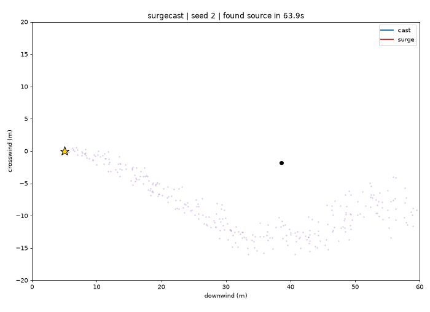
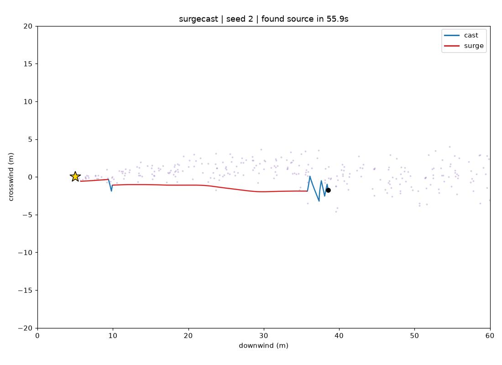
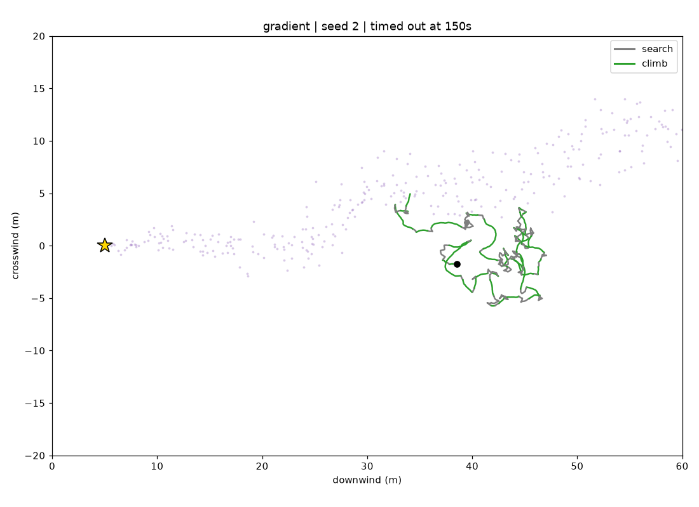

# moth-firefly → `surgecast`

Find the source of a smell, leak or plume the way a male moth finds a female: **surge upwind
when you smell it, cast crosswind when you lose it.** Not a metaphor, the actual algorithm.



## Why not just follow the gradient?

In turbulent air, odor arrives as patches with gaps between them. Two samples a moment apart
say almost nothing about which way the source is, so "go where it's stronger" wanders around
inside the plume and never closes in. Moths ignore the concentration level. They use only
*odor present / absent* plus the *wind direction* they feel on their antennae:

- **Surge:** odor detected → fly upwind.
- **Cast:** odor lost → zigzag crosswind, with each leg wider than the last, until it's back.

Two refinements make it faster:

- **Upwind means the recent average wind**, not the current gust. The odor reaching you left
  the source seconds ago on the wind of that time, so the averaged wind points back along the
  plume.
- **Casting keeps edging upwind** (about 20% of its effort). Any more than that and the agent
  overshoots the source, and nothing upwind of the source ever smells of anything.

Same 50 simulated plumes for every strategy (`surgecast bench`):

| agent | strategy | success | median time |
|---|---|---|---|
| `surgecast` | surge upwind on contact, cast crosswind on loss | **98%** | 56 s |
| `upwind` | surge on contact, random walk on loss (no casting) | 50% | 50 s |
| `gradient` | klinotaxis: keep heading while concentration rises | 0% | – |

The `upwind` row shows that casting is what makes this work. Surging alone loses the plume and
rarely finds it again (its median time is lower only because it succeeds just on the easy runs).

The refinements cut surgecast's median time from 78 s to 56 s on these seeds. The cost is
one near-miss in 50: a plume so sparse that the agent edged past it to finish level with the
source but 2.6 m to the side. In snakier wind (`--meander 0.6`) they help across the board,
raising success from 50% to 80% and cutting the median from 108 s to 73 s. Parameters were
tuned on seeds 100–149, which the benchmark seeds 0–49 don't overlap.

| surgecast | gradient (same plume) |
|---|---|
|  |  |

The puffs show the plume at the end of the run. The gradient agent spent most of its 150 s
*inside* the odor and still never reached the source.

## Use it

```bash
pip install -e '.[render]'        # numpy core; matplotlib only for plots

surgecast bench --trials 50                     # compare agents
surgecast run --seed 2 --out run.png            # plot one episode (.gif animates)
surgecast run --agent gradient --meander 0.6    # snakier wind
```

Environment knobs: `--wind` (m/s), `--meander` (wind direction wobble, rad), `--turbulence`
(puff patchiness), `--max-time`.

From Python:

```python
from surgecast import run_episode, bench, PlumeConfig
res = run_episode("surgecast", seed=0, plume_cfg=PlumeConfig(meander_sigma=0.5))
res.success, res.time, res.path
```

## The model

- **Plume** (`plume.py`): puffs leave the source at 5/s, ride a wind whose direction wanders
  (Ornstein-Uhlenbeck), random-walk individually, and spread as they age. This is a simplified
  version of the filament model from Farrell et al. 2002, *Filament-based atmospheric
  dispersion model to achieve short time-scale structure of odor plumes*.
- **Sensing:** binary detection above a threshold, plus the local wind vector.
- **Agent:** 0.8 m/s ground speed, starts 25–35 m downwind, wins within 1 m of the source.

## Roadmap

- v0 (this): simulation, three agents, benchmark, plots.
- v1: hardware. Feed a real gas sensor (MQ-series/BME688) and a wind vane into the same agent
  API as a handheld "which way?" guide.
- Later: several cheap nodes that share hits (the firefly half of the idea map; see
  [`ideas.md`](ideas.md)).

## Dev

```bash
uv venv && uv pip install -e '.[render,dev]' && .venv/bin/pytest
```
