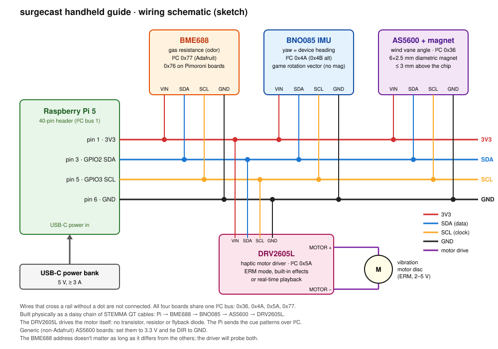
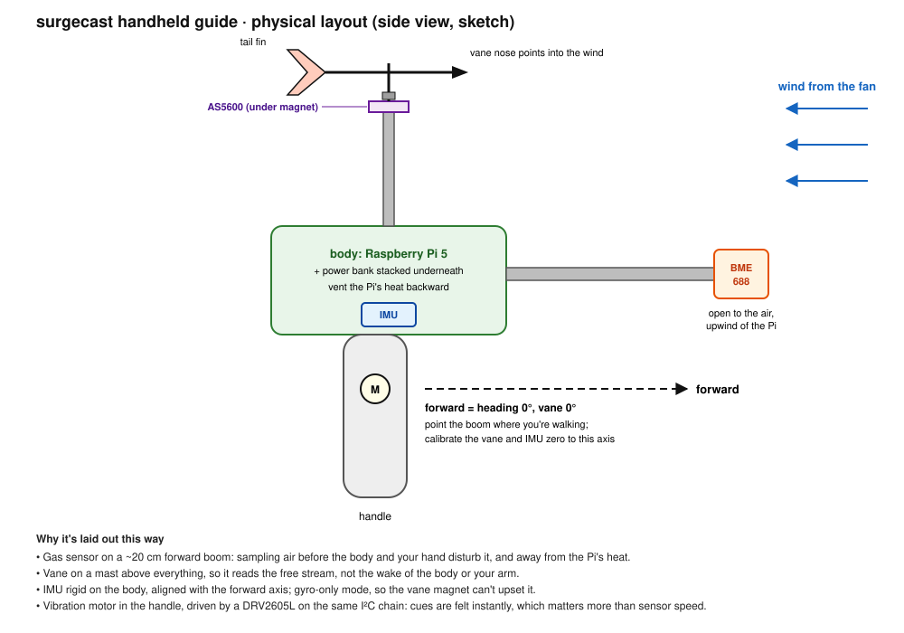

# v1 hardware: handheld guide

A handheld device that tells you which way to walk to find an odor source, using the same
surge-cast logic as the simulation. First test: indoors, a box fan for wind and an alcohol
swab or a dish of vinegar as the source.

```
 gas sensor ──┐
 wind vane  ──┼── I²C ── Raspberry Pi ── Guide ── cue ── I²C ── DRV2605L ── vibration motor
 IMU (yaw)  ──┘                                                 (felt in the handle, see below)
```

## Prototype sketches

How everything combines into one handheld: the wiring on the left, and where each part sits
and why on the right.

| wiring | physical layout |
|---|---|
| [](schematic.svg) | [](layout.svg) |

## Parts (~$70 from Adafruit, plus a magnet)

| part | what it does | I²C address | notes |
|---|---|---|---|
| **BME688** breakout (Adafruit 5046, or Pimoroni) | Gas resistance; falls as alcohol/VOCs rise | 0x77 (Adafruit) / 0x76 (Pimoroni) | Metal-oxide sensor with a seconds-scale response. The rise detector handles that (see below). |
| **AS5600** magnetic angle sensor (Adafruit 6357) + 6×2.5 mm **diametric** magnet | Reads the angle of a small wind vane | 0x36 (fixed) | The magnet is sold separately and must be diametrically magnetized. Generic boards often default to 5 V: set them to 3.3 V and tie DIR to GND. |
| **BNO085** IMU breakout (Adafruit 4754) | Device heading (yaw) | 0x4A (or 0x4B) | Use the gyro-only "game rotation vector", not the compass: indoors, and next to the vane's magnet, a magnetometer is unreliable. |
| **DRV2605L** haptic motor driver (Adafruit 2305) | Drives the vibration motor | 0x5A | Replaces a transistor + diode circuit. Built-in effect library and real-time playback for the cue patterns. |
| Vibrating mini motor disc (Adafruit 1201) | The cue you feel | (on the DRV2605L's motor terminals) | ERM motor. See *Feedback* below. |
| STEMMA QT cables: 1× to female sockets (4397), 3× 100 mm (4210) | Daisy-chain the I²C boards | | |
| USB-C power bank | Makes it handheld | | |

All four boards have different addresses (0x36, 0x4A, 0x5A, 0x77), so they share one I²C bus.
Where to buy, with prices and a cheaper mixed option, was researched in Oct 2026: the Adafruit
parts above come to about $69 before shipping and the magnet.

**Wind vane:** a light card or foam fin on a low-friction shaft, with the magnet glued to the
shaft end 0.5–3 mm above the AS5600 chip. It has to swing reliably in ~1 m/s of fan air.
Making that work is the main mechanical job.

## Wiring

Pi header I²C (bus 1): 3V3 → pin 1, SDA → pin 3, SCL → pin 5, GND → pin 6, using the cable
with female sockets. From there, daisy-chain STEMMA QT cables: BME688 → BNO085 → AS5600 →
DRV2605L. Solder or screw the motor's two leads to the DRV2605L's motor + and − terminals. No GPIO
pin is used.

Enable the header bus (it's off on this Pi today), then check that the boards show up:

```bash
sudo raspi-config nonint do_i2c 0   # then reboot
i2cdetect -y 1                      # expect 0x36, 0x4a, 0x5a and 0x77 (or 0x76)
```

## What the simulation already tells us

`surgecast guide` runs this exact software path on a simulated device: a slow, noisy gas
sensor, noisy vane and IMU, and a person following the instructions with a reaction delay.

- **Detect odor onsets, not levels.** With a 2 s sensor response, a level threshold drops
  surge-cast to 40–60% success. Firing on a fast rise keeps it at ~97–100%, even with an 8 s
  sensor. Insect odor neurons work the same way.
- **Recover from overshoot.** Indoors the source has the fan or a wall behind it. After 10 s
  without odor, the guide backs off downwind while sweeping. Without that, ~1 in 3 simulated
  walks ended pinned behind the source.
- **Your reaction time matters more than the sensor's.** Going from a 0.7 s to a 1.5 s
  reaction roughly doubles the search time, while a sensor 4× slower (2 s → 8 s) costs ~7 s.

Simulated results, 50 runs each:

| sensor response | reaction 0.7 s | reaction 1.5 s |
|---|---|---|
| 1 s | 100%, 14 s | 100%, 28 s |
| 2 s | 100%, 14 s | 100%, 29 s |
| 8 s | 100%, 21 s | 98%, 24 s |

## Feedback

Because reaction time dominates, instructions should register without reading: for example,
one buzz for "odor, go into the wind" and a left/right pattern for which way to cast. A screen
or spoken text can show the details, but shouldn't be what you have to wait for.

The DRV2605L plays the cue patterns from `hw/device.py` (`-` long, `.` short) over I²C, either
by sequencing effects from its built-in library or with real-time playback, where the Pi sets the
motor strength directly. Which one feels clearest is a test for when the parts arrive.

## Logging

Every session can be saved with `--log session.csv`. The real device will use the same format,
with the clean-air calibration in the header. `surgecast guide --replay session.csv` runs a log
back through the same live loop (`surgecast.hw.device.run_live`), so a real walk can be reviewed,
the detector retuned, and the result compared with the simulation.

## Still to do when the parts arrive

1. Drivers for the three sensors and the DRV2605L, each checked against the real chip (not
   written yet).
2. Calibrate the vane zero against the device's forward direction, and the clean-air gas
   resistance.
3. Measure the BME688's actual response time and achievable sample rate, then tune
   `RiseDetector.threshold` on real logs.
4. A `surgecast guide --device` mode. The live loop is done (`hw/device.py`); this step adds a
   `SensorSource` over the three sensor drivers and a DRV2605L `Feedback` playing the existing cue
   patterns.
5. Possible issue: on older Pis, the BNO085 has trouble with I²C clock stretching. If it misbehaves on the
   Pi 5, lower the bus speed or use its UART-RVC mode.
